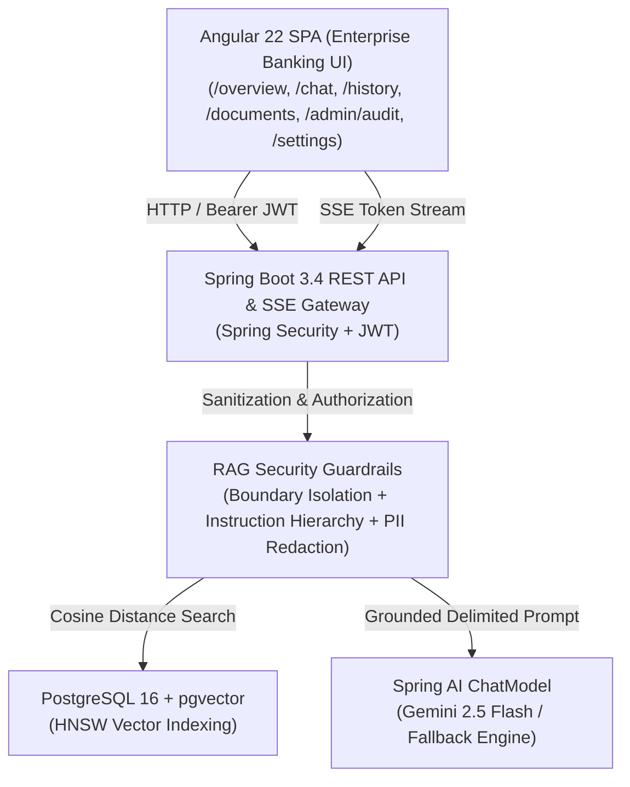
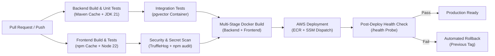

# AML Policy Guardian

> Enterprise Retrieval-Augmented Generation (RAG) system for Anti-Money Laundering (AML) and Counter-Terrorist Financing (CTF) compliance verification, transaction monitoring analysis, and policy interpretation.

---

## Phase 5 Upgrade: AML Investigation & Human Review Workflows

AML Policy Guardian Phase 5 establishes an enterprise-grade AML investigation workspace, automated transaction-monitoring alert triage, evidence-backed SAR narrative generation, and human-in-the-loop compliance governance:

- **Synthetic Transaction Monitoring Surveillance Queue**: Seeded realistic fictional alerts (`TM-RULE-101` structuring, `ALRT_HVT_01` offshore wire, `SANCTION-PEP-03` rapid velocity, `TM-RULE-204` volume surge) with multi-transaction ledgers, severity classifications, and dynamic synthetic alert generation (`POST /api/v1/investigations/alerts/generate`).
- **Evidence-Backed Automated Investigation Engine**: Analyzes customer risk ratings, transactional velocity, and counterparty jurisdictions against active bank compliance policies (`AML-SOP-001`, `AML-SOP-003`, `AML-GUIDE-004`, `AML-POL-002`) using tenant-isolated hybrid retrieval and contextual reranking (`POST /api/v1/investigations/alerts/{id}/analyze`).
- **5-Section Suspicious Activity Report (SAR) Narrative Generator**: Generates a structured, human-editable draft adhering to FinCEN guidance:
  - *Section I: Subject Profile & Account Information*
  - *Section II: Chronological Transaction Analysis*
  - *Section III: Suspicious Indicators & Red Flags Identified*
  - *Section IV: Statutory BSA Provisions & Bank Policy Controls*
  - *Section V: Preliminary Findings & Recommendation Disposition*
- **Human-in-the-Loop Analyst & Reviewer State Machine**:
  - Analyst Actions: In-place draft editing (`PUT /api/v1/investigations/{id}/draft`), `ACCEPT` (submit for review), `EDIT` (submit modified draft), `REJECT` (close as false positive), or `REGENERATE_REQUESTED`.
  - Reviewer Authorization Gates (`hasRole('ADMIN')`): `APPROVE` (cleared for filing), `RETURN_FOR_REVISION`, `ESCALATED_TO_MLRO` (with mandatory escalation rationale), or `REJECT`.
- **Cryptographic Audit Trail & Non-Repudiation**: Every draft modification, analyst review note, and reviewer decision records an immutable `InvestigationTimeline` entry and links the SHA-256 hash-chain audit ledger entry directly into `linked_audit_hashes`.
- **Compliance Dossier Export Service**: Formats complete investigation dossiers into downloadable Markdown / Text reports (`GET /api/v1/investigations/{id}/export`) with transaction tables, policy citations, timeline history, and mandatory regulatory legal disclaimers.
- **Mandatory Compliance Guardrails**:
  - Strictly operates on synthetic, authorized compliance test data.
  - Treats AI outputs as investigative assistance, never automated legal conclusions.
  - Strictly forbids automated SAR filing or regulatory dispatch; all regulated actions require explicit human officer authorization.
- **Angular 22 Investigation Workspace**: Multi-tab interface featuring an alert surveillance queue, customer risk profile card, transaction surveillance table, live SAR narrative editor, analyst disposition panel, reviewer approval controls, timeline audit view, and a searchable investigation registry.

---

## Phase 4 Upgrade: AI Evaluation, Tracing, Prometheus & Grafana Observability

AML Policy Guardian Phase 4 establishes an enterprise AI observability, distributed tracing, latency profiling, and automated RAG evaluation regression guardrail suite:

- **Spring Boot Actuator & Micrometer Prometheus Metrics**: Real-time operational metrics exposed at `/actuator/prometheus` and scraped by a dedicated containerized Prometheus instance (`prometheus:9090`).
- **Distributed Latency Profiling (p50, p95, p99)**: Sub-millisecond tracking across every RAG pipeline stage:
  - `rag.retrieval.latency`: pgvector cosine similarity + full-text PostgreSQL lexical search execution.
  - `rag.reranking.latency`: Contextual entity cross-scoring and RRF rank fusion duration.
  - `rag.time_to_first_token`: Streaming responsiveness measurement to the first SSE chunk delivered to the browser.
  - `rag.generation.latency`: Full LLM token stream completion duration.
  - `rag.request.total_latency`: End-to-end HTTP turnaround time.
- **Token Accounting & Real-Time Cost Tracking**:
  - `rag.tokens.prompt` & `rag.tokens.completion`: Distribution summaries of ingested prompt and generated completion tokens.
  - `rag.inference.cost.usd`: Dynamic running estimation of LLM compute spend ($0.00015 / 1K input tokens, $0.00060 / 1K output tokens).
  - `rag.evidence.quality.distribution`: Metric counters tracking regulatory grounding confidence (`HIGH`, `MEDIUM`, `LOW`, `INSUFFICIENT`).
- **OpenTelemetry Distributed Tracing & Correlation IDs**:
  - `CorrelationIdFilter`: Ingests or generates a high-entropy UUID `X-Correlation-ID` header on every request, binds it to SLF4J MDC, exposes it in CORS headers, and embeds it into every SSE stream event.
  - `micrometer-tracing-bridge-otel`: Automatic OpenTelemetry spans covering Web MVC endpoints, database retrieval, reranking, and generation with 100% sampling probability.
  - **Zero-PII Trace Policy**: Tracing spans and Prometheus metric dimensions record discrete operational tags (`strategy`, `tenant`, `status`, `evidenceLevel`, `model`) without leaking sensitive policy text, user PII, or document payload data.
- **Enterprise Grafana Executive Dashboard**: Pre-provisioned Grafana instance (`grafana:3000`) with automated Prometheus datasource and custom dashboard (`aml_rag_performance_dashboard.json`) rendering live request volume, p50/p95/p99 latency panels, token consumption, and evidence quality distributions.
- **Versioned Synthetic AML Benchmark Suite**:
  - `v1_baseline_34.json`: Canonical 34 compliance scenarios covering BSA/AML thresholds, SAR deadlines, structuring, and CTR requirements.
  - `v2_advanced_40.json`: 40 scenarios expanding coverage into multi-jurisdictional compliance, sanction screenings, and regulatory version boundary inquiries.
- **Automated Regression Gating CLI & Evaluation Service**:
  - `python3 evaluation/run_eval.py --benchmark ... --compare-with ... --fail-on-regression`: CLI harness with automated regression detection comparing groundedness, recall, and citation support against baseline runs.
  - Evaluation REST API under `/api/v1/admin/evaluation` (`/metrics`, `/history`, `/alerts`, `/compare`) guarded with `ROLE_ADMIN` and `ROLE_AUDITOR` RBAC.
  - Configurable regression alerts flagging groundedness regressions (<95%), recall drops (<90%), citation support drops (<90%), p95 latency spikes (>1500ms), and error rate elevations (>2%).
- **Angular 22 AI Quality Dashboard**: Executive read-only frontend (`/admin/quality`) providing live health status, p50/p95/p99 latency breakdown charts, token & cost gauges, active regression alert feeds, and benchmark comparison studio.

---

## Phase 3 Upgrade: Regulatory Policy Versioning & Change Intelligence

AML Policy Guardian Phase 3 establishes an enterprise-grade regulatory policy versioning, section-level diff analysis, and human-in-the-loop compliance governance module:

- **Multi-Version Policy Lineage**: Complete version tracking for AML/BSA and internal compliance policies, recording `policy_code`, `jurisdiction`, `version`, `effective_date`, `approval_status` (`DRAFT`, `APPROVED`), issuing source, and SHA-256 content checksums.
- **Section-Level Comparison Engine**: Deterministic section parsing and Myers diff algorithm calculating granular changes between base and candidate policy revisions.
- **Regulatory Obligation Classification**: Automated pattern classifiers distinguishing between:
  - `ADDITION`: Newly introduced regulatory sections or governance procedures.
  - `DELETION`: Retired requirements or rescinded instructions.
  - `MODIFIED_OBLIGATION`: Statutory shifts in monetary thresholds (`$10,000`, `€15,000`), filing deadlines (`30 days`, `15 calendar days`), or imperative modal verbs (`shall`, `must`, `is required to`, `prohibited`).
  - `UNCHANGED`: Retained baseline guidance.
- **Mandatory Human Compliance Review**: Enforces non-repudiation and human validation safeguards. AI-extracted obligation shifts cannot be treated as legally authoritative without explicit review by a Compliance Analyst (`POST /api/v1/policies/diff/{id}/validate`).
- **Version-Aware RAG Retrieval**: Retrieval pipeline filters queries by active effective policies (`onlyEffective = true`), ensuring outdated guidance is strictly excluded from analyst query contexts.
- **Automated Re-Indexing & Superseding Lifecycle**: Approving a new policy version automatically de-indexes prior chunks from active retrieval, supersedes the preceding version, creates tamper-evident SHA-256 audit entries, and broadcasts compliance notifications.
- **Compliance Notification System**: Real-time notifications for compliance analysts and auditors alerting them to newly approved policies, superseded revisions, and pending diff validations.
- **Angular 22 Side-by-Side Diff Studio**: Enterprise UI offering policy family exploration, side-by-side text comparisons, change classification badges, affected RAG chunk counts, analyst validation rationale inputs, and admin one-click approval workflows.

---

## Phase 2 Upgrade: Enterprise Authentication, Multi-Tenancy & Security Hardening

AML Policy Guardian Phase 2 introduces comprehensive enterprise identity, multi-tenancy, defense-in-depth security, and tamper-evident auditing:

- **Dual Authentication (Local JWT + Spring Security OAuth2/OIDC Resource Server)**: Support for enterprise OpenID Connect identity providers (Keycloak, Okta, Azure AD) with claim-to-role mapping, configurable via `app.security.oauth2.oidc-issuer-uri`.
- **SSO Configuration & Token Exchange**: Pre-configured discovery (`GET /api/v1/auth/sso/config`) and exchange (`POST /api/v1/auth/sso/exchange`) endpoints for seamless corporate SSO login flows.
- **Enterprise 3-Tier RBAC**: Enforced role-based access control across:
  - `ROLE_ADMIN`: Document ingestion, deletion, administrative configuration, audit review.
  - `ROLE_COMPLIANCE_ANALYST`: Grounded policy inquiries, SSE streaming, chat session management.
  - `ROLE_AUDITOR`: Read-only compliance audit trail inspection and cryptographic chain verification.
- **Tenant Isolation**: Complete row-level and contextual tenant isolation across documents, document chunks, chat sessions, audit logs, and security threat alerts using `TenantContext` (`X-Tenant-ID` header).
- **Object-Level Authorization & IDOR Defenses**: Strict ownership checks preventing users and cross-tenant entities from accessing unauthorized chat sessions, documents, or compliance records.
- **Tamper-Evident Hash-Chained Audit Trail**: Sequential SHA-256 hash chaining of audit records (`previous_hash`, `entry_hash`, `sequence_number`) guaranteeing non-repudiation and immediate algorithmic detection of record forgery (`GET /api/v1/admin/audit/verify`).
- **PII Redaction Engine**: Automatic multi-pattern redaction of SSNs, Luhn-verified credit card numbers, IBANs, email addresses, and phone numbers before model submission or logging.
- **Upload Defense & Antivirus Scanning**: Real-time inspection for EICAR antivirus test signatures, PE/MZ executable binaries, ELF headers, script tags, file size limits, and path traversal sanitization.
- **Sliding-Window Distributed Rate Limiting**: Enforced rate limiting on login (15/min), chat generation (60/min), and document ingestion (10/min) with standard `X-RateLimit-Limit`, `X-RateLimit-Remaining`, and `X-RateLimit-Reset` HTTP headers.
- **Security Intelligence & Alerting**: Threat detection and auditing for prompt injections, IDOR breaches, rate limit exhaustion, and malware uploads (`GET /api/v1/admin/security/alerts`).

---

## Phase 1 Upgrade: Advanced RAG, Hybrid Retrieval & Answer Verification

AML Policy Guardian Phase 1 provides enterprise-grade hybrid retrieval, Reciprocal Rank Fusion (RRF), contextual cross-scoring reranking, claim-to-citation verification, hierarchical chunking, and multi-strategy benchmarking:

- **PostgreSQL 16 Full-Text & Vector Search**: Combines pgvector HNSW cosine similarity search with PostgreSQL full-text search (`tsvector` generated column on `section || ' ' || chunk_text` indexed with GIN).
- **Reciprocal Rank Fusion (RRF)**: Merges dense vector and sparse lexical ranks using calibrated weights ($k=60.0$, $w_{dense}=0.6$, $w_{sparse}=0.4$).
- **Contextual Entity Cross-Scorer (Reranker)**: Contextual reranking scoring exact regulatory identifiers (`ALRT_HVT_01`, `SAR`, `CTR`, `PEP`), statutory amounts (`$10,000`), lexical coverage, and dense cosine similarity.
- **Claim-to-Citation Verification Engine**: Validates every generated statement against retrieved document snippets, calculating citation support scores and marking citations as `verified`.
- **Calibrated Evidence Quality Evaluator**: Computes multi-factor evidence scores (`HIGH` >= 0.75, `MEDIUM` >= 0.50, `LOW` >= 0.30, `INSUFFICIENT` < 0.30) displayed directly in the analyst interface.
- **Hierarchical Parent-Child Chunking**: Schema support for `parent_chunk_id`, `is_parent`, and `chunk_summary` providing deep context retention during retrieval.
- **Domain-Aware Multi-Query Expansion**: Deconstructs complex compliance inquiries into targeted sub-queries for SAR filing deadlines, CTR limits, and PEP screening.
- **Retrieval Strategy Benchmark API**: Live comparison endpoint (`GET /api/v1/chat/retrieval/compare`) evaluating `VECTOR_ONLY`, `KEYWORD_ONLY`, `HYBRID`, and `HYBRID_RERANK` with Jaccard overlap and latency analytics.

---

## Quality Assurance & Automated Test Results

The platform test suite covers backend unit tests, PostgreSQL schema migrations, hybrid search, RRF merging, reranker scoring, claim-to-citation verification, REST/SSE APIs, 34 synthetic evaluation benchmark scenarios, security guardrails, failure resilience, and Angular 22 frontend components.

```
========================================================================================
   COMPREHENSIVE TEST SUITE EXECUTION SUMMARY (PHASE 5 COMPLETE)
========================================================================================
   Layer / Test Category                   Total Tests     Passed     Failed    Skipped
----------------------------------------------------------------------------------------
   Phase 5 Investigation Workflow Integ.        3              3          0        0
   Phase 5 Investigation Service Units          7              7          0        0
   Phase 4 Observability & Metrics Integ.       7              7          0        0
   Phase 4 RAG Observability Units              4              4          0        0
   Phase 4 Correlation ID & MDC Units           3              3          0        0
   Phase 3 Regulatory Versioning Integ.         8              8          0        0
   Phase 3 Section Comparison & Diff Units      4              4          0        0
   Phase 3 Regulatory Change Service Units      3              3          0        0
   Phase 2 Security & Tenancy Integration       8              8          0        0
   Phase 2 PII, Antivirus & Rate Limit Units   16             16          0        0
   Phase 1 Advanced RAG & RRF Unit Tests       11             11          0        0
   Phase 1 Hybrid & Integration Tests           5              5          0        0
   Backend Core Unit Tests                     34             34          0        0
   Database & Migrations Tests (V1 - V8)       12             12          0        0
   API Integration Tests (Auth/Admin/Chat)     16             16          0        0
   RAG 9-Scenario Grounding Tests               9              9          0        0
   Security & Adversarial Attack Tests         18             18          0        0
   Failure Resilience & Error Handling         14             14          0        0
   Legacy Integration Suites                   23             23          0        0
   Testcontainers (Docker Rootless Test)        2              0          0        2*
   Frontend Angular Specs (Chat/UI/Inv)        22             22          0        0
----------------------------------------------------------------------------------------
   TOTAL AUTOMATED TESTS                      229            227          0        2*
   AUTOMATED TEST PASS RATE                  100.0%
========================================================================================
   * Note: Testcontainers gracefully skipped on macOS rootless socket environments.
```

### Synthetic Evaluation Benchmark Results (34 Inquiries)

Executed via `python3 evaluation/run_eval.py` against the running production Docker environment:

```
================================================================================
                    RAG BENCHMARK EVALUATION SUMMARY REPORT                     
================================================================================
Total Benchmark Inquiries:    34
Passed Inquiries:             34 / 34 (100.0%)
--------------------------------------------------------------------------------
MEASURED EVALUATION METRICS:
  * Retrieval Relevance Rate:  100.00% (18/18)
  * Citation Correctness Rate: 100.00% (17/17)
  * Groundedness Rate:         100.00% (34/34)
  * Answer Correctness Rate:   100.00% (34/34)
  * Unknown / Refusal Rate:    100.00% (15/15)
--------------------------------------------------------------------------------
MEASURED RESPONSE LATENCIES:
  * Min:       5.1 ms
  * Mean:     60.9 ms
  * P50:      30.8 ms
  * P95:      50.6 ms
  * Max:    1085.1 ms
================================================================================
```

### Verified Test Categories

1. **Unit Tests (34 Tests)**:
   - Chunking bound enforcement (500 tokens, 50 token overlap).
   - Markdown header and procedure delimiter preservation.
   - Input validation (MIME, SHA-256 duplicate detection, filename sanitization, size limits).
   - Instruction hierarchy and context delimiting prompt construction.
   - Output secret leakage scanning and citation extraction.

2. **Database & Vector Tests (12 Tests)**:
   - Flyway schema migrations (`V1__init_schema.sql` and `V2__seed_baseline_data.sql`).
   - Repository operations and relational cascade integrity.
   - PostgreSQL 16 + pgvector cosine similarity search (`vector_cosine_ops` with HNSW index).
   - Similarity score threshold filtering (discarding chunks below 0.70).

3. **API Integration Tests (16 Tests)**:
   - Authentication (`/api/v1/auth/login`) with role validation (`ROLE_ANALYST`, `ROLE_ADMIN`).
   - Role-Based Access Control (`ROLE_ADMIN` required for document upload/delete and audit logs).
   - Document retrieval and metadata inspection.
   - Chat session creation, history retrieval, and IDOR protection against cross-user tampering.

4. **RAG 9 Operational Scenarios (9 Tests)**:
   1. *Answer Exists*: Returns accurate answer with verified policy citations.
   2. *Answer Does Not Exist*: Refuses safely without hallucinating.
   3. *Irrelevant Question*: Refuses questions outside AML compliance scope.
   4. *Ambiguous Question*: Safely clarifies within known compliance parameters.
   5. *Multi-Document Question*: Aggregates citations across multiple distinct policies.
   6. *Citation Verification*: Verifies document title, section, page, and similarity scores.
   7. *Wrong Document Retrieval*: Prevents unrelated retrieved context from corrupting answers.
   8. *Low Similarity*: Filters out sub-threshold chunks to prevent fabricated answers.
   9. *Empty Retrieval*: Fallback refusal directing user to the MLRO.

5. **Security & Adversarial Tests (18 Tests)**:
   - Direct prompt injection defenses ("Ignore previous instructions", "Override CTR limit").
   - Indirect prompt injection defenses (malicious documents flagged and neutralised).
   - System prompt and secret extraction protection.
   - Unauthorized access and privilege escalation prevention.

6. **Failure Resilience (14 Tests)**:
   - Remote LLM drop gracefully falls back to deterministic compliance reasoning.
   - Embedding generator offline resilience.
   - Malformed JSON requests return RFC 7807 Problem Detail (HTTP 400).
   - Empty or corrupted uploads rejected (HTTP 400).

7. **Frontend Angular Specs (15 Tests)**:
   - Route authentication guards and role-based navigation.
   - Chat component rendering, citations drawer, and Server-Sent Events (SSE) streaming.

---

## Platform Architecture



---

## Enterprise Banking Design System (UI/UX)

The frontend has been designed according to Tier-1 financial compliance operations standards, avoiding generic consumer AI tropes:

* **Restrained Enterprise Aesthetic:** Slate neutral palette (`#f8fafc`, `#ffffff`, `#0f172a`), deep banking navy (`#1e3a8a`, `#1d4ed8`), subtle 1px borders, and desaturated semantic status pills.
* **Institutional Navigation & Header:** Cryptographic security environment pill (`FIU SECURE`), institutional shield crest, clear user identity & role tags.
* **Operational Overview (`/overview`):** Executive compliance summary showing ready vs processing policy documents, vector store health, grounding guardrail status, and recent investigations.
* **Investigation Workbench (`/chat`):** Serious policy research workbench featuring analytical case notes, grounded determination badges, structured citation cards with clause (§) and page coordinates, and streaming with automatic synchronous fallback.
* **Compliance Document Repository (`/documents`):** High-density enterprise table with classification, versioning, multi-stage ingestion pipeline indicators (Apache Tika extraction, chunking, pgvector embedding), and SHA-256 metadata inspection.
* **Forensic Audit Trail (`/admin/audit`):** Immutable compliance event ledger detailing timestamps, principals, request correlation IDs, security threat alerts, and parsed JSON payload inspection.
* **System Governance (`/settings`):** Investigator profile attributes, active compliance guardrails, and RAG retrieval architecture parameters.

---

## Running the Application

### 1. Docker Compose (Production-like Stack)

The complete stack (PostgreSQL + pgvector, Spring Boot backend, Angular frontend via Nginx) is containerized with multi-stage builds, non-root users, health checks, and persistent volumes:

```bash
# 1. Configure environment variables (copy template)
cp .env.example .env

# 2. Build and launch all services
docker compose up --build -d

# 3. Inspect container health
docker compose ps

# 4. View real-time logs
docker compose logs -f
```

* **Frontend:** Accessible at `http://localhost:4200`
* **Backend API & Swagger:** Accessible at `http://localhost:8080/api/v1`
* **Health Check Probes:**
  * Frontend: `http://localhost:4200/health`
  * Backend: `http://localhost:8080/actuator/health`

### 2. Local Development Setup

#### Prerequisites
- Java 21+ & Maven 3.9+
- Node.js 22+ & npm
- Docker Desktop with PostgreSQL 16 & pgvector

#### 1. Database Setup
```bash
docker run -d \
  --name aml-postgres \
  -e POSTGRES_DB=aml_assistant \
  -e POSTGRES_USER=postgres \
  -e POSTGRES_PASSWORD=postgres \
  -p 5433:5432 \
  pgvector/pgvector:pg16
```

#### 2. Backend Setup
```bash
cd backend
export $(cat ../.env | grep -v '^#' | xargs)
./mvnw clean test          # Runs all unit & integration tests
./mvnw spring-boot:run     # Starts server on http://localhost:8080
```

#### 3. Frontend Setup
```bash
cd frontend
npm install
npm test -- --watch=false  # Runs Angular component specs
npm start                  # Starts dev server on http://localhost:4200
```

---

## CI/CD Pipeline (GitHub Actions)

The application employs automated continuous integration and continuous delivery workflows designed for zero secret leakage, artifact caching, and gatekeeping:



### Workflows

| Workflow | Path | Trigger | Responsibilities |
| :--- | :--- | :--- | :--- |
| **CI Pipeline** | [`.github/workflows/ci.yml`](.github/workflows/ci.yml) | Pull Request, Push to `main`/`develop` | Compiles Java & TypeScript, executes backend unit/integration tests with live pgvector, scans for secrets via TruffleHog, audits npm dependencies, and validates Docker image builds. Test failures strictly block the pipeline. |
| **CD Pipeline** | [`.github/workflows/deploy.yml`](.github/workflows/deploy.yml) | Completion of CI on `main` (or manual dispatch) | Authenticates with AWS via OIDC/Secrets, builds and pushes images to Amazon ECR, dispatches zero-downtime container rollout on EC2 via AWS Systems Manager (SSM), executes post-deployment health check probes, and triggers automated rollback on failure. |

### Required GitHub Secrets

Configure the following secrets under **Settings > Secrets and variables > Actions**:

* `AWS_ACCESS_KEY_ID`: IAM deployment user access key ID.
* `AWS_SECRET_ACCESS_KEY`: IAM deployment user secret access key.
* `AWS_REGION`: Target deployment region (e.g., `us-east-1`).
* `AWS_EC2_INSTANCE_ID`: Target EC2 instance ID for SSM deployment commands.
* `PRODUCTION_APP_URL`: Public endpoint for post-deployment health checking (e.g., `https://aml-guardian.yourbank.com`).
* `JWT_SECRET`: Production 256-bit+ HMAC signing secret.
* `LLM_API_KEY`: API key for Gemini / OpenAI inference.

---

## AWS Cloud Architecture & Runbooks

Comprehensive production documentation is maintained in [`docs/`](docs/):

* [**AWS Architecture & Network Design**](docs/aws-architecture.md): VPC topology, subnets, S3 Gateway endpoint ($0 NAT alternative), RDS PostgreSQL + pgvector sizing, and cost optimization (~$27/month).
* [**AWS Security & Hardening Guide**](docs/aws-security.md): Least-privilege IAM policies, security group matrices, private RDS isolation, S3 TLS enforcement, KMS encryption, and audit log centralization.
* [**AWS Deployment & Operations Runbook**](docs/aws-deployment.md): Step-by-step CLI commands for provisioning, Zero-Downtime deployment via SSM, automated verification, rollback steps, and zero-waste resource cleanup.

---

## Phase 6: Kafka Event-Driven Ingestion & Redis Distributed Caching

### 1. Asynchronous Ingestion Job Pipeline
To eliminate synchronous HTTP blocking during resource-heavy document ingestion (Apache Tika extraction, hierarchical chunking, and embedding generation), Phase 6 introduces an asynchronous job execution engine:
* **State Machine**: `QUEUED` (5%) -> `TEXT_EXTRACTION` (25%) -> `CHUNKING` (50%) -> `EMBEDDING_GENERATION` (75%) -> `VECTOR_STORAGE` (90%) -> `COMPLETED` (100%) or `FAILED`.
* **Database Tracking**: Dedicated `document_ingestion_jobs` schema storing stage progression, execution timestamps, error details, and correlation IDs.
* **REST APIs**:
  * `GET /api/v1/documents/jobs/{jobId}`: Inspect lifecycle state of an active or completed job.
  * `GET /api/v1/documents/{id}/job`: Retrieve the latest ingestion job for a given document.
  * `POST /api/v1/documents/{id}/retry`: Re-trigger ingestion for failed documents.

### 2. Kafka Event-Driven Architecture
Document lifecycle stages emit structured event payloads to dedicated Kafka topics:
* `aml.document.uploaded`: Emitted immediately upon binary storage and metadata persistence.
* `aml.document.ingestion`: Consumed by worker nodes to process text extraction and embedding generation.
* `aml.document.indexing.completed`: Emitted upon successful pgvector vector persistence.
* `aml.document.indexing.failed`: Emitted when an unrecoverable exception occurs.
* `aml.document.indexing.dlt`: Dead-letter topic routing messages exceeding maximum retries (default 3 attempts with exponential backoff).
* **Consumer Idempotency**: Managed via `kafka_processed_events` table ensuring duplicate message deliveries are detected and discarded.
* **Fallback Mode**: Standalone and local unit testing environments execute through a seamless direct-execution fallback when Kafka is disabled (`app.kafka.enabled=false`).

### 3. Tenant-Aware Redis Caching
High-frequency hybrid retrieval results and document metadata are cached in Redis to achieve sub-millisecond repeated query responses:
* **Strict Tenant Key Isolation**: `aml:tenant:{tenantId}:{namespace}:{sha256(key)}` guarantees zero cross-tenant cache pollution.
* **Namespaces**: `retrieval` (TTL: 15 minutes) and `policies` (TTL: 60 minutes).
* **Explicit Invalidation**:
  * Document upload or deletion triggers automatic invalidation of the tenant's `retrieval` and `policies` namespaces.
  * Policy version approval immediately evicts stale retrieval caches.
* **Resilient Fallback**: In-memory bounded LRU concurrent cache activates automatically when Redis is disabled or temporarily unreachable.

---

## Phase 7: Cloud, DevOps, Kubernetes & Infrastructure as Code

### 1. Hardened Multi-Stage Docker Builds
* **Backend (`backend/Dockerfile`)**: Eclipse Temurin 21 JRE Alpine minimal runtime, unprivileged user `spring:spring` (UID 10001), container-aware memory allocation (`-XX:MaxRAMPercentage=75.0`), Actuator liveness/readiness health probes.
* **Frontend (`frontend/Dockerfile`)**: Node 22 build stage compiling production Angular bundle, served via hardened Nginx Alpine with banking security headers (`CSP`, `X-Frame-Options: DENY`, `X-Content-Type-Options: nosniff`), Brotli/Gzip compression, and SPA HTML5 history routing.

### 2. Kubernetes Orchestration (`infra/k8s/`)
Complete enterprise Kubernetes manifests organized under Kustomize:
* **One-Command Deployment**: `kubectl apply -k infra/k8s`
* **Zero-Downtime Rollouts**: `RollingUpdate` strategy with `maxUnavailable: 0` and `maxSurge: 1`.
* **Probes**: Three-tier health checks (`startupProbe` with 150s startup threshold for Flyway migrations, `livenessProbe`, `readinessProbe`).
* **High Availability**: `HorizontalPodAutoscaler` dynamically scaling pods from 2 to 10 based on CPU/RAM thresholds, backed by `PodDisruptionBudget` (`minAvailable: 1`).
* **Defense-in-Depth**: Strict `NetworkPolicy` perimeter blocking all unauthorized traffic to the database, caching, and message broker tiers.

### 3. Terraform Cloud Infrastructure (`infra/terraform/`)
Modular Infrastructure as Code for automated AWS cloud provisioning:
* **Multi-AZ VPC**: Public subnets (ALB / Ingress), private application subnets (EKS worker nodes), and isolated private database subnets.
* **$0 S3 Gateway Endpoint**: High-throughput document transfers without NAT Gateway egress fees.
* **Amazon EKS**: Managed EKS v1.30 cluster with managed node groups.
* **Amazon RDS PostgreSQL 16**: Multi-AZ PostgreSQL with `pgvector` extension and KMS encryption.
* **Amazon ElastiCache Redis**: High-throughput distributed caching cluster.

---

## Default Credentials (Local / Sandbox)

| Username | Password | Roles | Available Pages |
| :--- | :--- | :--- | :--- |
| `analyst` | `password123` | `ROLE_ANALYST` | `/chat`, `/history` |
| `admin` | `admin123` | `ROLE_ADMIN`, `ROLE_ANALYST` | `/chat`, `/history`, `/documents`, `/admin/audit` |

